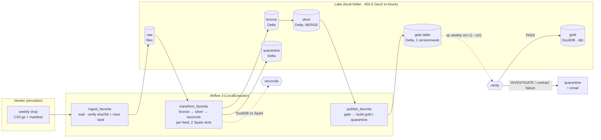

# retail-lakehouse

[](https://github.com/Luke458/retail-lakehouse/actions/workflows/ci.yml)

A weekly retail data pipeline that refuses to publish numbers it can't
vouch for.

A vendor drops a week of store × item sales every Wednesday. The pipeline
checks the delivery, lands it, conforms it on Delta Lake, reconciles two
engines against each other, and asks a quality gate,
[verity](https://github.com/Luke458/verity), whether the week looks like a
real week before any of it reaches the reporting tables. A week the gate
doesn't approve is quarantined. Gold keeps serving the last approved data,
and someone gets an email saying why.

Data: Corporación Favorita (Ecuador), the public Kaggle grocery dataset,
2013-2017, cut into Wednesday-Tuesday weekly drops by a vendor simulator
that can also break them on purpose (late, corrupt, duplicated, renamed
columns, unparseable rows, restatements, a missing store). Public data only.

## Architecture



| Layer | What happens | Code |
|---|---|---|
| Inbox → raw | Wait for the drop's manifest (late drops are a sensor, not a failure); verify sha256 and row counts; land idempotently (same bytes, no-op; new bytes, atomic swap recording what it replaced) | `dags/ingest_favorita.py`, `landing.py` |
| Raw → bronze | Header checked against the contract (a renamed column fails before anything is written); typed with an explicit schema; unparseable rows go to quarantine with a reason, up to 1%; one partition per week, replaced on rerun | `spark/bronze.py` |
| Bronze → silver | Deduplicate (exact and conflicting duplicates counted), then MERGE: update changed rows only (row hash), insert new, delete what the vendor stopped sending. Rerunning an unchanged week commits nothing | `spark/silver.py` |
| Reconcile | DuckDB reads the raw file independently and must agree with Spark: raw = bronze + quarantine, parsed = bronze, distinct keys = silver, sums equal. No retry: a mismatch is a finding | `spark/reconcile.py` |
| Gate | The week's store × item units are written as a new version of the gate's own Delta table; verity compares it with the previous version (contracts, missing stores and products, history revisions, the latest week against its forecast). PASS publishes; anything else quarantines, and a person can release the week | `gate.py`, `dags/publish_favorita.py` |
| Gold | dbt-duckdb, incremental by week, reading only approved weeks; 22 tests plus "every served week equals silver"; source freshness | `dbt/` |

## What it has shown

Measured on the real data, with the numbers and the reasoning in `notes/`:

- **Week 1:** a 10-week backfill green; a corrupt drop retried and
  alerted; a late drop waited for; a republish is byte-identical.
  (`week-01.md`)
- **Week 2:** 30/30 feed-weeks reconcile between DuckDB and Spark;
  duplicates, unparseable rows, a schema change and a restatement each
  handled and counted. (`week-02.md`)
- **Week 3, the gate:**
  - **The fault it should catch:** a missing store (5.6% of units) is
    blocked, gold is unchanged, and the alert names store S44.
  - **The fault it misses:** a 0.04% restatement passes, under verity's
    materiality.
  - **False alarms:** the gate blocked **9 of 20 clean weeks**, each with a
    cause visible in the data. Examples: a base year missing 600 products,
    Carnaval moving a week, the April 2016 earthquake.

  (`week-03.md`)
- **Week 4, CI:** `scripts/ci.sh` runs the GitHub Actions stages locally
  in about 75 s. A gold filter bug, a task without retries and an unused
  import each fail their stage. (`week-04.md`)
- **Week 5, Azure:** OpenTofu for ADLS Gen2 and Databricks, plus the job;
  `tofu validate` passes; the Spark jobs take their paths from config.
  Code only: nothing applied. (`week-05.md`)
- **Week 6:** this README, the runbook, a fresh-clone run, and a fix for
  silver's MERGE, which had been rewriting the whole table every week.
  (`week-06.md`)

Why it's built this way, and what breaks at 100x: `notes/decisions.md`.

## Run it

Needs Linux (the scripts use GNU `date`), [uv](https://docs.astral.sh/uv/), JDK 17 or 21 for
Spark (`JAVA_HOME`, or `LAKEHOUSE_JAVA_HOME`; the default is
`~/.local/opt/jdk-21.0.13+9`), about 1 GB for the source data, and a few GB
for the demo lake.

```bash
git clone <this repo> retail-lakehouse && cd retail-lakehouse
scripts/setup.sh                 # four venvs: Airflow, Spark, dbt, verity (pinned)
scripts/get-data.sh              # Favorita parquet, ~900 MB, sha256-checked
scripts/ci.sh all                # lint, tests, fixture dbt build, infra validate (~75 s)

scripts/mail.sh &                # SMTP catcher on :1025; alerts land in data/mail/new/
scripts/airflow.sh &             # Airflow on http://localhost:8088 (user admin)
scripts/demo.sh                  # 30 weeks end to end, the last 4 through the gate (~40 min)
scripts/stop.sh                  # stop Airflow
```

The admin password is in `.airflow/simple_auth_manager_passwords.json.generated`.
`demo.sh` ends with a table of verity's verdict and whether gold serves
each gated week. For anything after that (replay a week, break one on
purpose, release a quarantined week), see [`docs/runbook.md`](docs/runbook.md).

Ports: Airflow 8088 and mail 1025, movable with `AIRFLOW_PORT` and
`MAIL_PORT`. The Airflow metadata DB (SQLite) and everything the pipeline
writes stay inside the repo (`.airflow/`, `data/`).

## Layout

| Path | What |
|---|---|
| `dags/` | `ingest_favorita`, `transform_favorita`, `publish_favorita` (weekly), `ingest_reference` (on demand) |
| `src/retail_lakehouse/` | `drops.py` (vendor simulator), `landing.py`, `spark/` (bronze, silver, reconcile), `gate.py`, `gold.py` (fingerprint), `fixture.py` (CI lake) |
| `dbt/` | staging and gold models, tests, macros (`week_filter`: approved weeks only) |
| `config/verity/` | verity's Favorita configuration |
| `infra/` | OpenTofu: Azure resource group, ADLS Gen2, Databricks workspace, Unity Catalog, the transform job |
| `scripts/` | setup, data, run and stop, CI, backfill, replay, demo, package |
| `.github/workflows/` | CI on pull requests; deploy bundle on `main` |
| `notes/` | weekly notes with proof, design decisions |
| `docs/runbook.md` | operating it |
